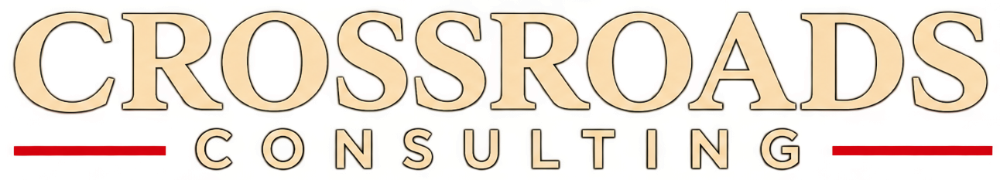

# Crossroads Consulting - Employee Portal

The guild addon for **Crossroads Consulting** in World of Warcraft: Forever.

## Install or update

1. Download **[CrossroadsConsulting-Setup.exe](https://github.com/MarkCOL92/crossroads-consulting-releases/releases/latest/download/CrossroadsConsulting-Setup.exe)**
2. Run it. Windows may say *"Windows protected your PC"* because the file isn't signed: click **More info** and then **Run anyway**.
3. Click **Install**.

The setup always installs the newest version, so just run it again to update. Your settings are kept.

Manual install: download the zip from the [latest release](https://github.com/MarkCOL92/crossroads-consulting-releases/releases/latest)
and unzip it into `World of Warcraft\_forever_\Interface\AddOns\`.